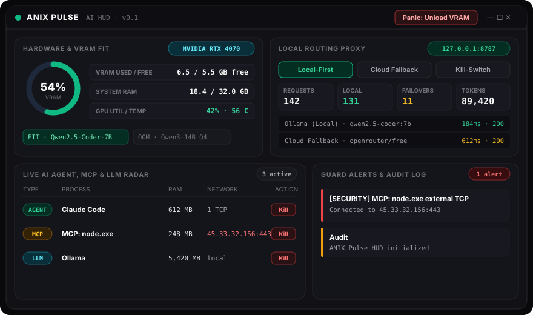

<div align="center">

# ✦ anix.pulse ✦
### *Minimalist Rust + Tauri v2 HUD, TCP Network Audit &amp; Kill-Switch for Local AI Agents*

[](https://github.com/an1zy/anix-pulse/actions/workflows/ci.yml)
[](https://www.rust-lang.org/)
[](https://tauri.app)
[](https://github.com/an1zy/anix-pulse/releases)
[](LICENSE)

**English** · [Русский](README.ru.md)

<br/>



</div>

---

Native desktop HUD in the **anix** monochrome glass aesthetic (~7.2 MB standalone Windows binary, zero Node/npm build dependencies). Built to keep tabs on coding agents, MCP servers, and local LLM runtimes running at the same time.

## What It Does

- **Process &amp; TCP Radar (`radar.rs`)**: Tracks running coding agents (`Claude Code`, `Codex`, `OpenCode`, `Cursor`, `Antigravity`, `Windsurf`, `Aider`, `Cline`), local runners (`Ollama`, `llama.cpp`, `LM Studio`, `vLLM`), and MCP servers. Masks `--api-key`/`--token` flags in CLI strings and shows outbound TCP sockets per PID.
- **Hardware &amp; VRAM Fit (`hardware.rs`)**: Reads NVIDIA VRAM/temp via `nvidia-smi`, system RAM via `sysinfo`, active Ollama models (`/api/ps`), and flags which local models fit into free VRAM.
- **PID Kill-Switch &amp; Tray Unload (`actions.rs`)**: Terminate any stuck agent/MCP process directly from the table or unload active Ollama models via **Unload VRAM** (window header or tray menu).
- **Local OpenAI Proxy (`proxy.rs`)**: Listens on `http://127.0.0.1:8787/v1` with `Local-First`, `Cloud Fallback`, and `Kill-Switch` modes plus request/latency/token counters.
- **Guard Rules**: Raises alerts when an MCP opens an external TCP socket, a process crosses your RAM cap, or VRAM saturation passes threshold.

## Build from Source

Requires Rust (`stable`) and Windows WebView2 (pre-installed on Windows 10/11).

```bash
git clone https://github.com/an1zy/anix-pulse.git
cd anix-pulse/src-tauri
cargo test
cargo build --release
```

Pre-built Windows binaries are in [Releases](https://github.com/an1zy/anix-pulse/releases).

## License

MIT © 2026 [an1zy](https://github.com/an1zy)
