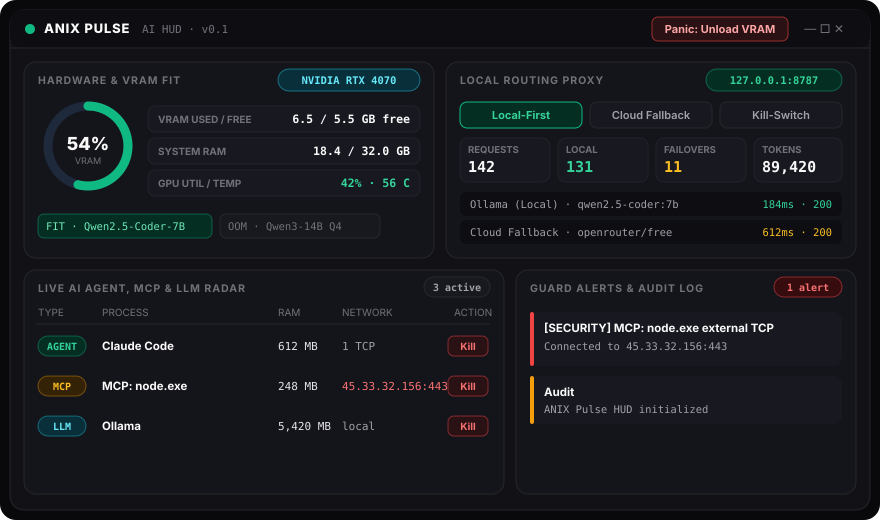

<div align="center">

# ✦ anix.pulse ✦
### *Минималистичный Rust + Tauri v2 HUD, сетевой аудит и стоп-кран для AI-агентов и локальных LLM*

[](https://github.com/an1zy/anix-pulse/actions/workflows/ci.yml)
[](https://www.rust-lang.org/)
[](https://tauri.app)
[](https://github.com/an1zy/anix-pulse/releases)
[](LICENSE)

[English](README.md) · **Русский**

<br/>



</div>

---

Нативный десктопный HUD в монохромном стеклянном стиле **anix** (~7.2 МБ exe на Windows, без Node/npm). Показывает всё, что крутится на машине из AI-агентов, MCP-серверов и локальных моделей.

## Что умеет

- **Радар процессов и TCP-сокетов (`radar.rs`)**: находит процессы агентов (`Claude Code`, `Codex`, `OpenCode`, `Cursor`, `Antigravity`, `Windsurf`, `Aider`, `Cline`), локальных движков (`Ollama`, `llama.cpp`, `LM Studio`, `vLLM`) и MCP-серверов. Маскирует `--api-key`/`--token` и показывает внешние TCP-подключения по PID.
- **VRAM и Hardware Fit (`hardware.rs`)**: снимает загрузку/температуру NVIDIA через `nvidia-smi`, RAM через `sysinfo`, загруженные модели Ollama (`/api/ps`) и показывает, что влезает в свободную VRAM.
- **Kill-Switch и выгрузка VRAM (`actions.rs`)**: убийство любого PID из таблицы и быстрая выгрузка моделей Ollama из VRAM через **Unload VRAM** или меню трея.
- **Локальный OpenAI-прокси (`proxy.rs`)**: слушает `http://127.0.0.1:8787/v1` с режимами `Local-First`, `Cloud Fallback` и `Kill-Switch`.
- **Алерты**: реагирует на внешние TCP-соединения MCP-серверов, превышение лимита RAM на процесс и забитую VRAM.

## Сборка

Нужен только Rust (`stable`) и системный WebView2.

```bash
git clone https://github.com/an1zy/anix-pulse.git
cd anix-pulse/src-tauri
cargo test
cargo build --release
```

Готовые сборки под Windows лежат в [Releases](https://github.com/an1zy/anix-pulse/releases).

## Лицензия

MIT © 2026 [an1zy](https://github.com/an1zy)
